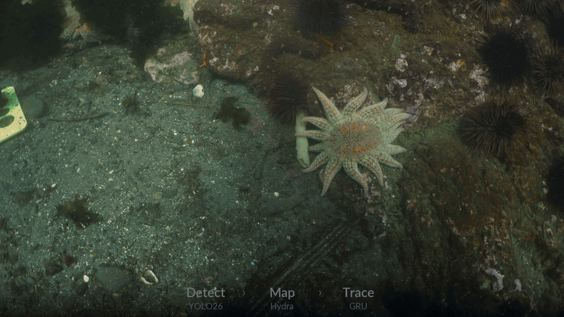
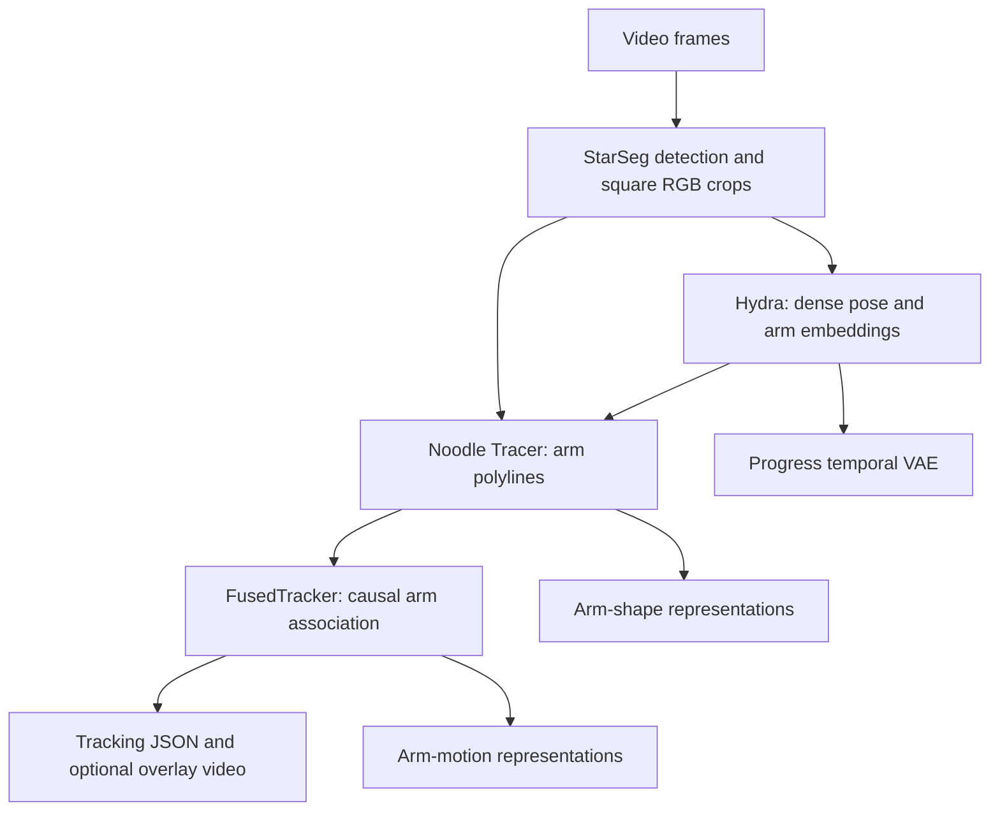

# DeepStarNoodles

DeepStarNoodles traces every arm of a sunflower sea star (*Pycnopodia
helianthoides*) as a curve from base to tip, in images and video. A detector
finds each animal, a field network (Hydra) predicts 18 dense maps for each
crop, and a recurrent tracer (Noodle Tracer) walks each arm from tip to base.
It is research software for studying posture and movement from recorded
imagery.



**Status:** research release accompanying the DeepStarNoodles methods paper.
The released evaluation supports per-image arm tracing. Video `track_id` values
are causal associations for visualization and downstream analysis; they are
not validated measurements of biological arm identity.

| What | Where |
| --- | --- |
| Code (this repository) | Training, evaluation, reference inference, behaviour representations |
| Models | [Hugging Face `weertman/deepstarnoodles`](https://huggingface.co/weertman/deepstarnoodles) (gated) and the GitHub release [`models-20261117`](https://github.com/weertman/deepstarnoodles-inference/releases/tag/models-20261117) (no login) |
| Arm dataset | [Hugging Face `weertman/deepstarnoodles-data`](https://huggingface.co/datasets/weertman/deepstarnoodles-data) (gated), version `noodles_final_20261026` |
| Fast video inference | [`deepstarnoodles-inference`](https://github.com/weertman/deepstarnoodles-inference): a packaged, compiled pipeline for long recordings |
| Annotating an archive on rented GPUs | [`backcast/`](backcast/README.md) |

Start with the [quick start](#quick-start), use the [project map](#project-map)
to navigate the code, or jump to [training and evaluation](#training-and-evaluation),
[video inference](#advanced-video-inference), and
[behavior representations](#behavior-representations).

## Pipeline



- **StarSeg** detects sunflower stars and creates a square crop around each
  detection.
- **Hydra** combines a DINOv3 ConvNeXt-Base backbone with an FPN and prediction
  heads to produce an 18-channel dense field: ten geometry, landmark, and
  endpoint channels plus an eight-channel arm embedding.
- **Noodle Tracer** uses the image crop and dense field to generate one
  base-to-tip polyline for each detected arm.
- The **fused tracker** assigns video-local association IDs to arm
  observations using body-relative shape and identity embeddings. Multi-star
  mode first assigns animal IDs with BoT-SORT and keeps an independent arm
  tracker for each animal.

The released Hydra operates on 512×512 RGB crops. Its channel contract is
defined in [`model.py`](CORE/deepstarnoodles/model.py):

| Channels (zero-based) | Meaning |
| --- | --- |
| 0–1 | Arm support and centerline |
| 2–3 | Arm direction (`dx`, `dy`) |
| 4 | Progress along the arm |
| 5–7 | Mouth, madreporite, and anus (`butthole` in the code) |
| 8–9 | Arm base and tip |
| 10–17 | Eight-dimensional arm-identity embedding |

[`HydraPredictor`](CORE/deepstarnoodles/hydra.py) exposes both raw and
activated fields, including batch APIs. Noodle Tracer consumes the **raw**
fields and aligned RGB; tracking uses activated geometry and decoded arms.
Representations are separate Python APIs and are not automatically exported by
the video commands.

## Quick start

Run these commands from the repository root. Python 3.11 is the tested
environment; a CUDA-capable GPU is recommended.


### 1. Create the environment

```bash
python3.11 -m venv .venv
source .venv/bin/activate
python -m pip install --upgrade pip
```

Install PyTorch 2.6 and torchvision 0.21 using the
[official 2.6 installation instructions](https://pytorch.org/get-started/previous-versions/#v260)
so the wheel matches the host CUDA version. Then install the remaining
dependencies and the Hugging Face CLI:

```bash
python -m pip install -r requirements.txt
python -m pip install --no-deps -e .
python -m pip install --upgrade huggingface_hub
```

The editable install exposes `deepstarnoodles` from `CORE/` while retaining
access to the checkout's configuration and vendored DINOv3 source. As an
alternative to the editable install, set `export PYTHONPATH="$PWD/CORE"` in
each shell. The pinned environment is in [`requirements.txt`](requirements.txt);
installing the package alone does not install that complete environment.


### 2. Download models and data

The published models are in a gated
[Hugging Face model repository](https://huggingface.co/weertman/deepstarnoodles).
Request access, then download them into the checkout:

```bash
hf auth login
hf download weertman/deepstarnoodles --local-dir MODELS
(cd MODELS && sha256sum -c SHA256SUMS)
```

This gives `MODELS/starseg_binary.pt`, `starseg_fine.pt`, `starseg_coarse.pt`,
`hydra.pt` and `tracer.pt`. The same files are assets of the GitHub release
[`models-20261117`](https://github.com/weertman/deepstarnoodles-inference/releases/tag/models-20261117),
which needs no login. `hydra.pt` already contains the fine-tuned DINOv3
ConvNeXt-Base backbone, so **inference needs no other download**.

Training Hydra needs Meta's pretrained backbone, which is distributed
separately under the DINOv3 License. Follow the
[official DINOv3 access instructions](https://github.com/facebookresearch/dinov3)
and place this file in `MODELS/dinov3/`:

```text
dinov3_convnext_base_pretrain_lvd1689m-801f2ba9.pth
SHA-256 801f2ba95801bdcc9a8b77e293d38b35b355dbc813ef609cd82e18c3a185e8da
```

Training and scoring Hydra and the tracer need the
[arm dataset](https://huggingface.co/datasets/weertman/deepstarnoodles-data).
Download it into `DATA`, where the paths in its split indexes resolve:

```bash
hf download weertman/deepstarnoodles-data --repo-type dataset --local-dir DATA
```

Check the downloads against the [artifact manifest](config/artifacts.json):

```bash
python SCRIPTS/validate_artifacts.py \
  --roles runtime-detector released-dense released-tracer \
    training-split validation-split test-split
```

Add `alternative-detector` to also check the fine and coarse detectors, and
`pretrained-backbone` if you downloaded the Meta file. Validation hashes the
files listed in the manifest; it does not hash every image.

The detection dataset on which the detectors were trained and scored is the
frozen version `starseg_yolo26_20261106` (7,978 images; 5,600 / 1,129 / 1,249
for training, validation and test). The Hugging Face repository
[`weertman/starseg`](https://huggingface.co/datasets/weertman/starseg)
currently holds an earlier three-class version of that dataset.

### 3. Process a video

```bash
python SCRIPTS/infer_video.py \
  --video path/to/video.mp4 \
  --output RUNS/infer/tracks.json \
  --overlay RUNS/infer/overlay.mp4
```

The default mode follows one focal animal and writes frame-aligned arm
polylines and association IDs to `tracks.json`. The optional overlay provides
a visual check of the detector, crop, and traced arms. Each frame record
contains the frame number, detection status, crop metadata, and arm records.
Each arm includes its `track_id`, crop- and source-coordinate polylines, and
identity embedding.

The video commands choose `cuda:0` when CUDA is available and otherwise use
CPU. Set `--device cpu` or `--device cuda:1` explicitly when needed, and use
`--max-frames 100` for a short smoke run. Single-star mode initially selects the
largest detection, then favors a detection near the previous center; use
`--multi-star` when separate animal identities are required.


The video commands use `MODELS/starseg_binary.pt`, `MODELS/hydra.pt` and
`MODELS/tracer.pt` by default; pass `--starseg MODELS/starseg_fine.pt` (or
`starseg_coarse.pt`) to use another detector. The published `tracer.pt` stores
no invalid-seed threshold, so the video commands apply 0.6, the value chosen
on the validation split; `--invalid-seed-threshold` overrides it.

## Reported results

These are the results of the paper, for the published models on the frozen
datasets.

### Detection

Detection of sunflower sea stars on the 1,249 test images. A prediction and an
annotated mask match one to one at a mask intersection over union of at least
0.5, at a confidence of at least 0.25. Values are precision / recall / F1.

| Detector | All | Laboratory | Field without PWS | PWS |
| --- | --- | --- | --- | --- |
| binary (`starseg_binary.pt`, the detector of the paper) | 0.920 / 0.903 / 0.911 | 0.906 / 0.924 / 0.915 | 0.918 / 0.668 / 0.774 | 0.976 / 1.000 / 0.988 |
| fine (`starseg_fine.pt`, 37 classes) | 0.941 / 0.902 / 0.921 | 0.932 / 0.925 / 0.928 | 0.924 / 0.658 / 0.768 | 0.992 / 0.996 / 0.994 |
| coarse (`starseg_coarse.pt`, 4 classes) | 0.934 / 0.909 / 0.921 | 0.926 / 0.927 / 0.926 | 0.920 / 0.690 / 0.789 | 0.976 / 1.000 / 0.988 |

PWS is the dive surveys of one cruise in Prince William Sound, Alaska (243
test images). It is reported apart from the other field images (152 test
images) and is not pooled with them. The three detectors differ in how objects
other than sunflower sea stars were labelled in training; with any of them,
only sunflower sea star detections are cropped and traced. Each is a single
training run, and differences of about one point between them are within what
a change of seed produces.

### Arm tracing

Hydra and the tracer on annotated test crops (crops cut from the annotations,
so detector errors are not included). A traced arm and an annotated arm match
when their symmetric Chamfer distance is at most 8 px in the 512 px crop.

| Test crops | Crops | Annotated arms | Precision | Recall | F1 |
| --- | --- | --- | --- | --- | --- |
| All | 553 | 5,685 | 0.821 | 0.798 | 0.809 |
| Development test set | 493 | 4,890 | 0.807 | 0.784 | 0.795 |
| StarDome rig | 30 | 419 | 0.927 | 0.905 | 0.915 |
| StarTrack rig | 30 | 376 | 0.882 | 0.854 | 0.868 |

The development test set was scored repeatedly while the method was built. The
two rigs were not, but both are in our laboratory. Arm accuracy with each
detector in the loop was not measured separately.

## Limitations

- The detectors found about 92% of animals in laboratory images but about 67%
  in field images outside PWS. Field use needs more annotated field images.
- The tracer draws extra arms on animals with few arms, and the number of
  traced arms equals the annotated number in about one third of crops, so a
  count of arms from a single frame is unreliable.
- The development test set was scored repeatedly while the method was built,
  the field network has no test score of its own, and the two rigs not scored
  during development are in our laboratory.
- Video arm identities have no annotation: their consistency can be measured
  but not their accuracy, and they do not carry through a flip.
- Retraining reproduces the recipe, not the published weights; see
  [training and evaluation](#training-and-evaluation).
- Lengths are in pixels. The pipeline provides no physical calibration.
- The detectors run with Ultralytics, and their training data and class
  definitions limit how far they generalize.

## Released models and data

| File | Model | SHA-256 |
| --- | --- | --- |
| `starseg_binary.pt` | Detector, YOLO26-L segmentation; classes `sunflower_star`, `not_sunflower` | `1a38e2dab1a3e6937297e397fc7778f05746a8db2b64b851b561d6379d1f2592` |
| `starseg_fine.pt` | Detector, 37 classes | `d46917b7a5e8eaecf337c2ddbd0e128aa2b24d54a6b6a98392118a44b5254699` |
| `starseg_coarse.pt` | Detector, 4 classes | `5a268a704e677d463221a2c262c8ae1f43ed4db401dd7a68fb93f6988a34323c` |
| `hydra.pt` | Field network, DINOv3 ConvNeXt-Base, 18 maps | `aa056f933c1a0994fb299203aa20423c5208637d2eb4ede7e942abcc3aa91d7c` |
| `tracer.pt` | Noodle Tracer, GRU with 128 hidden units; invalid-seed threshold 0.6 | `e6c1506067fc5864ab1d0d648dec2f7932632017d952753cb68f80fed2c4812f` |

All were trained with seed 0 on the frozen datasets. The detector files are the
terminal checkpoints of their runs, with the training machines' absolute paths
replaced by relative ones; [`config/artifacts.json`](config/artifacts.json)
gives the hashes of both versions and of the dataset files.

The arm dataset `noodles_final_20261026` has 5,093 crops (4,062 training, 478
validation, 553 test) with 57,055 arm polylines and 6,346 landmark points.
Splits keep acquisition groups (`split_group_id`) together. Of the test crops,
493 come from sources scored repeatedly during development; the other 60 come
from two newer laboratory rigs, StarDome and StarTrack.

### Earlier releases

Until 2026-11-17 this repository and its Hugging Face repositories held
development models from August and October 2026 (a YOLOv8 detector, two Hydra
checkpoints, two tracers and a temporal VAE) and an earlier version of the arm
dataset (split 4,062 / 478 / 502). They were trained before the datasets were
frozen and are not the models of the paper. They remain in the history of the
Hugging Face repositories (models: revision
`0881c427eb0f1f564ef76fbd8399173121169132`; arm data: revision
`9590c93f0eac2ad39924ad81902ccafa626e77ec`), are listed in
`config/artifacts.json` with role `earlier-model` or `earlier-dataset`, and
their selection and test records are in [`config/locked/`](config/locked/) and
[`docs/published-tracer.md`](docs/published-tracer.md).

## Project map

| Path | Contents |
| --- | --- |
| [`CORE/deepstarnoodles/`](CORE/deepstarnoodles/) | Importable Python package; models, data, decoding, tracking, and representations |
| [`CORE/noodle_polylines/`](CORE/noodle_polylines/) | Torch-free polyline representations of the paper figures |
| [`SCRIPTS/`](SCRIPTS/) | Training, evaluation, validation, and inference commands |
| [`config/`](config/) | Artifact hashes, tracer normalization, evaluation records, and tracking settings |
| [`docs/`](docs/) | Representation API and earlier recipe documentation |
| [`huggingface/`](huggingface/) | Model and dataset cards of the Hugging Face repositories |
| [`backcast/`](backcast/README.md) | Annotating a long archive of 1 fps video on rented GPUs, then tracking and representations |
| [`tests/`](tests/) | Unit, integration, and optional local-artifact checks |
| [`examples/`](examples/), [`benchmarks/`](benchmarks/) | Micro example data and scripts; benchmark and parity tools |
| [`external/dinov3/`](external/dinov3/) | Vendored DINOv3 source under Meta's license |
| `DATA/` | Downloaded datasets; excluded from git |
| `MODELS/` | Downloaded and trained checkpoints; excluded from git |
| `RUNS/` | Generated caches, training, evaluation, and inference outputs; excluded from git |

### Core modules

| Area | Entry points and responsibilities |
| --- | --- |
| Detection and crops | [`crop.py`](CORE/deepstarnoodles/crop.py): `StarCropper` for one focal animal; `TrackedStarCropper` for BoT-SORT animal IDs and per-animal crops |
| Dense model | [`model.py`](CORE/deepstarnoodles/model.py): DINOv3 backbone, FPN, prediction heads, and output specification; [`hydra.py`](CORE/deepstarnoodles/hydra.py): checkpoint loading, preprocessing, and batched prediction |
| Dense training | [`dataset.py`](CORE/deepstarnoodles/dataset.py): indexed images, annotations, target rasterization, and augmentation; [`train.py`](CORE/deepstarnoodles/train.py): optimization, validation, and checkpoints; [`embedding_loss.py`](CORE/deepstarnoodles/embedding_loss.py): arm-identity objectives |
| Learned tracing | [`noodle_tracer.py`](CORE/deepstarnoodles/noodle_tracer.py): recurrent tracer, checkpoint I/O, `trace_arms_noodle`, and `trace_arms_noodle_batch` |
| Tracer training data | [`noodle_tracer_cache.py`](CORE/deepstarnoodles/noodle_tracer_cache.py): frozen dense/RGB caches and split contracts; [`noodle_tracer_data.py`](CORE/deepstarnoodles/noodle_tracer_data.py): teacher actions and rollout supervision |
| Geometric baselines | [`decode.py`](CORE/deepstarnoodles/decode.py): field activation, peaks, and geometric decoding; [`decode_embed.py`](CORE/deepstarnoodles/decode_embed.py): embedding-aware decoding and trace filtering |
| Video runtime | [`runtime.py`](CORE/deepstarnoodles/runtime.py): per-star tracker registry, coordinate conversion, JSON records, and overlays; [`fused_tracker.py`](CORE/deepstarnoodles/fused_tracker.py): arm association |
| Evaluation | [`evaluate_decode.py`](CORE/deepstarnoodles/evaluate_decode.py): dense/geometric evaluation; [`evaluate_noodle_tracer.py`](CORE/deepstarnoodles/evaluate_noodle_tracer.py): tracer/baseline comparisons, bootstrap statistics, and validation locks; [`metrics.py`](CORE/deepstarnoodles/metrics.py): path metrics |
| Data preparation and strata | [`build_ignore_masks.py`](CORE/deepstarnoodles/build_ignore_masks.py): ignore polygons for unannotated neighboring stars; [`annotation_strata.py`](CORE/deepstarnoodles/annotation_strata.py): annotation-derived evaluation strata |
| Experimental temporal logic | [`temporal_quality.py`](CORE/deepstarnoodles/temporal_quality.py) and opt-in lifecycle modes in `fused_tracker.py`; the [tracking lock](config/temporal_tracking/locked.json) retains the legacy fused associator for released inference |
| Behavior features | [`representations/`](CORE/deepstarnoodles/representations/): `arm_bag.py`, `arm_motion.py`, `progress.py`, `temporal_vae.py`, `temporal_training.py`, and `io.py`; see the [representation guide](docs/representations.md) |
| Paths and public exports | [`paths.py`](CORE/deepstarnoodles/paths.py): artifact defaults and portable dataset paths; [`__init__.py`](CORE/deepstarnoodles/__init__.py): top-level model and representation exports |

`paths.py` derives defaults from the checkout. Set `DEEPSTARNOODLES_ROOT` before
importing the package to override that root for APIs using these defaults.
Several scripts resolve their own paths from the checkout, so use their explicit
path arguments as well when working with another artifact location. Video
commands accept `--starseg`, `--hydra`, and `--tracer` checkpoint overrides.

### Command reference

Run Python entry points with `--help` for their full arguments.

| Entry point | Purpose |
| --- | --- |
| [`SCRIPTS/infer_video.py`](SCRIPTS/infer_video.py) | One video; single- or multi-star tracking, JSON, and optional MP4 overlay |
| [`SCRIPTS/infer_videos.py`](SCRIPTS/infer_videos.py) | Round-robin video streams sharing batched Hydra/tracer inference |
| [`SCRIPTS/benchmark_inference.py`](SCRIPTS/benchmark_inference.py) | Synchronized stage timings and hardware/checkpoint provenance |
| [`SCRIPTS/benchmark_cascade.py`](SCRIPTS/benchmark_cascade.py) | Throughput of the resident detector → crop → Hydra → tracer cascade on stills or one replayed stream |
| [`SCRIPTS/validate_artifacts.py`](SCRIPTS/validate_artifacts.py) | Manifest-based presence and SHA-256 checks; standard library only |
| [`SCRIPTS/train_starseg.sh`](SCRIPTS/train_starseg.sh) | YOLO26-L segmentation training with the published detectors' recipe |
| [`SCRIPTS/build_starseg_three_class.py`](SCRIPTS/build_starseg_three_class.py) | Convert an upstream multi-class YOLO dataset to the earlier three-class layout |
| [`SCRIPTS/train_hydra.py`](SCRIPTS/train_hydra.py) / `python -m deepstarnoodles.train` | Train or fine-tune Hydra |
| [`SCRIPTS/train_noodle_tracer_refreshed.py`](SCRIPTS/train_noodle_tracer_refreshed.py) | Train the published tracer recipe end to end: refreshed generations of every training crop, 30 cycles |
| [`SCRIPTS/train_noodle_tracer_shared.py`](SCRIPTS/train_noodle_tracer_shared.py) | Train several tracer sizes and controls from one shared refreshed generation per cycle |
| [`SCRIPTS/generate_refreshed_tracer_cache.py`](SCRIPTS/generate_refreshed_tracer_cache.py) | One refreshed generation: pixel-space augmentation and a fresh Hydra pass for each training image |
| [`SCRIPTS/cache_fixed_tracer_split.py`](SCRIPTS/cache_fixed_tracer_split.py) | Cache a fixed validation split, or a locked test split, for one cohort |
| [`SCRIPTS/evaluate_tracer_split.py`](SCRIPTS/evaluate_tracer_split.py) | Score and compare tracer checkpoints on a fixed validation or locked test split |
| [`SCRIPTS/write_tracer_normalization.py`](SCRIPTS/write_tracer_normalization.py) | Write fixed dense normalization statistics from a cached training split |
| [`SCRIPTS/cache_frozen_outputs.py`](SCRIPTS/cache_frozen_outputs.py) | Prepare Sleepy, non-Sleepy, or all-family split contracts and cache Hydra fields plus aligned RGB |
| [`SCRIPTS/train_noodle_tracer.py`](SCRIPTS/train_noodle_tracer.py) | Train the recurrent tracer on a frozen-output study or one refreshed cycle |
| [`SCRIPTS/calibrate_noodle_tracer.py`](SCRIPTS/calibrate_noodle_tracer.py) | Select validation thresholds and export a calibrated checkpoint (earlier recipe) |
| [`SCRIPTS/evaluate_noodle_tracer.py`](SCRIPTS/evaluate_noodle_tracer.py) | Evaluate the tracer and geometric baselines; optionally lock validation for held-out testing (earlier recipe) |
| `python -m deepstarnoodles.evaluate_decode` | Evaluate geometric decoders against dense-dataset annotations |
| `python -m deepstarnoodles.build_ignore_masks` | Generate neighbor-star ignore masks for dense training |

## Training and evaluation

These are the commands that trained the published models. They write new
artifacts under `RUNS/` and reproduce the recipe, not the published weights:
training uses mixed precision on the GPU and is not bit-deterministic.

### StarSeg

Obtain `yolo26l-seg.pt` (COCO-pretrained) from Ultralytics and place it in
`MODELS/starseg/`. The script expects the frozen detection dataset in
`DATA/starseg_yolo26_20261106/`, with one YOLO dataset per label scheme in
`arms/B`, `arms/F` and `arms/C`:

```bash
SCHEME=B SEED=0 SCRIPTS/train_starseg.sh   # binary; F = fine, C = coarse
```

The recipe is AdamW at a learning rate of 2.44e-4 with cosine decay, 50 epochs
at 1024 px, nominal batch 64 (micro-batch `BATCH`, default 4), and mosaic
switched off for the last 10 epochs. The published detectors are the terminal
checkpoints, `train/weights/last.pt`. The script uses the first visible CUDA
device.

### Hydra

```bash
python -m deepstarnoodles.train \
  --out-dir RUNS/hydra_seed0 \
  --train-index DATA/noodles_final_20261026/splits/train_index.csv \
  --val-index DATA/noodles_final_20261026/splits/validation_index.csv \
  --ignore-shapes-dir DATA/noodles_final_20261026/ignore_masks \
  --seed 0 --batch-size 8 --epochs 194 --max-steps 98250 \
  --degrade-p 0.4 --backbone-llrd 0.7 --ema-decay 0.999 \
  --embedding-dim 8 --embedding-loss-weight 0.5 --embedding-warmup-epochs 4 \
  --image-cache-dir RUNS/hydra_seed0/cache/images512 \
  --target-cache-dir RUNS/hydra_seed0/cache/targets \
  --num-workers 4 --save-every 10 --save-visuals-every 20
```

This needs the Meta backbone file from the quick start. Checkpoints are written
to a timestamped subdirectory of `--out-dir`; the published `hydra.pt` is the
terminal checkpoint, `last.pt`, which holds the exponential moving average of
the weights. The published run took about 24 hours on one GPU.

### Noodle Tracer

The tracer is trained on the outputs of a frozen Hydra. First fix the
normalization of its 18 maps from the non-Sleepy training crops:

```bash
python SCRIPTS/cache_frozen_outputs.py \
  --stage all --cohort non_sleepy --cache-splits train \
  --split-dir DATA/noodles_final_20261026/splits \
  --checkpoint MODELS/hydra.pt \
  --output RUNS/tracer_seed0/normalization

python SCRIPTS/write_tracer_normalization.py \
  RUNS/tracer_seed0/normalization/cache/train_manifest.json \
  RUNS/tracer_seed0/normalization/normalization.json
```

The result for `hydra.pt` is shipped as
[`config/recipes/noodle_tracer_published_normalization.json`](config/recipes/noodle_tracer_published_normalization.json),
so these two steps can be skipped. Then train:

```bash
python SCRIPTS/train_noodle_tracer_refreshed.py \
  --output RUNS/tracer_seed0/tracer \
  --checkpoint MODELS/hydra.pt \
  --normalization-json config/recipes/noodle_tracer_published_normalization.json \
  --split-dir DATA/noodles_final_20261026/splits \
  --cohort all --validation-cohort all \
  --cycles 30 --steps-per-cycle 4000 \
  --seed 0 --augmentation-seed 20261026 \
  --generation-batch-size 4 --no-prefetch \
  --trainer-args "--hidden-size 128"
```

The command:

- prepares a study of all 4,062 training crops and caches the fixed 478-crop
  validation split, which is scored after every cycle;
- runs 30 cycles. Each cycle regenerates the training data: every crop gets
  fresh flips, quarter turns, and brightness, contrast, and saturation changes,
  applied to the pixels and the annotated arm polylines alike, and Hydra is
  rerun on the augmented crop. The tracer then makes exactly 4,000 updates at
  batch size 1, resuming from the previous cycle;
- warms the learning rate up over two cycles, then decays it from 3e-4 to 3e-5
  on a cosine schedule, and ramps rollout training (scheduled sampling) to 30%
  by cycle 12. The RGB encoder is torchvision's ImageNet-pretrained
  MobileNetV3-Small, kept frozen; the first run downloads its weights if they
  are not cached.

Each cycle caches about 27 GB, deleted once the cycle has trained unless
`--keep-generations` is set. Re-running the same command resumes after the last
completed cycle. The published `tracer.pt` is the checkpoint after cycle 30,
`RUNS/tracer_seed0/tracer/training/g0030/last.pt`.

Score a checkpoint on the validation split, at an invalid-seed threshold of
your choice:

```bash
python SCRIPTS/evaluate_tracer_split.py \
  --split-root RUNS/tracer_seed0/tracer/validation/all \
  --split validation \
  --checkpoint RUNS/tracer_seed0/tracer/training/g0030/last.pt \
  --invalid-seed-threshold 0.6 \
  --out-json RUNS/tracer_seed0/validation_all.json
```

The evaluator pools precision, recall, and F1 over crops, averages F1 over
`split_group_id` groups, and, given several `--checkpoint` arguments, gives
paired group-bootstrap F1 differences against the first. The published
threshold, 0.6, was chosen on the validation split.

#### Adapting the tracer to new scenes

The same pipeline trains on your own annotated images. You need:

- one annotation file per image: a JSON list of shapes in which each arm is
  `{"label": "arm", "type": "polyline", "points": [x0, y0, x1, y1, ...]}` in
  source-image pixels, ordered from the central disk to the arm tip. CVAT
  polyline annotations exported to this layout work directly;
- `train_index.csv`, `validation_index.csv`, and `test_index.csv` in one
  directory, with the columns `image_path`, `shapes_path`, `width`, `height`,
  and `split_group_id`. Paths may be absolute or relative to the repository
  root. Put related captures (the same animal, session, or video) in one
  group; no group may span two splits.

Train with `--cohort all --validation-cohort all`. To start from the published
weights instead of a random initialization, add `--init-checkpoint`:

```bash
python SCRIPTS/train_noodle_tracer_refreshed.py \
  --output RUNS/noodle_tracer_my_scene \
  --checkpoint MODELS/hydra.pt \
  --normalization-json config/recipes/noodle_tracer_published_normalization.json \
  --split-dir path/to/my_splits \
  --cohort all --validation-cohort all \
  --init-checkpoint MODELS/tracer.pt \
  --trainer-args "--hidden-size 128" \
  --cycles 10
```

- The learning rate still warms up and then decays over `--cycles`; add, for
  example, `--lr 1e-4` to `--trainer-args` to lower its peak. Fine-tuning
  budgets have not been benchmarked, so choose the number of cycles on your
  validation split.
- For a small dataset, `--draws-per-image 4` gives each image four different
  augmentations per cycle, so the 4,000 updates of a cycle (`--steps-per-cycle`)
  see more distinct views.
- To keep accuracy on the original scenes, append your rows to the published
  split indexes instead of replacing them.
- The tracer starts from Hydra's tip detections and reads its dense maps. If
  Hydra misses arms in the new scene, fine-tune Hydra first (see
  [Hydra](#hydra), with `--init-checkpoint MODELS/hydra.pt`), pass it with
  `--checkpoint`, and write a matching normalization file as above; the shipped
  statistics describe `hydra.pt`.

#### Test access

Test crops are cached only after the analysis is locked.
`cache_fixed_tracer_split.py --split test` requires `--analysis-lock`, a JSON
file that sets `test_access_locked` and records the SHA-256 of the test index
(`test_source_index_sha256`), the Hydra checkpoint
(`frozen_checkpoint_sha256`), and the normalization file
(`normalization_sha256`). `evaluate_tracer_split.py --split test` takes the
same lock and scores only checkpoints whose hashes the lock records under keys
ending in `checkpoint_sha256`.

### Dense geometric decoding

The following evaluates Hydra's standard and embedding-aware geometric
decoders on the 553 test crops:

```bash
python -m deepstarnoodles.evaluate_decode \
  --mode model \
  --checkpoint MODELS/hydra.pt \
  --index DATA/noodles_final_20261026/splits/test_index.csv \
  --split all \
  --out-json RUNS/evaluate_decode/test.json
```

This measures Hydra's geometric decoders, not the Noodle Tracer.

## Advanced video inference

Single-video inference uses a dense/tracer batch size of one for minimum live
latency. The default arm-association parameters are `--shape-gate 120`,
`--embed-weight 2.0`, `--max-age 16` and `--max-match-cost 90`. Age counts
unmatched tracker updates; frames without decoded arms do not advance the arm
tracker. A pairing costing more than the match-cost cap starts a new ID instead
of taking over another arm's track; `--max-match-cost 0` restores the earlier
behaviour (no cap), which produced more identity switches. These parameters
are configurable through both video commands.

### Output contract

Both video commands use the serializers in
[`runtime.py`](CORE/deepstarnoodles/runtime.py):

| Output | Structure |
| --- | --- |
| Single-star JSON | Top-level `video` and `frames`; each frame has `frame`, `detected`, `crop`, and `arms`. This format has no `schema_version` field. |
| Multi-star JSON | Top-level `schema_version: 2`, `video`, `tracking`, and `frames`; each frame has `frame`, `detected`, and `stars`. Each star has `star_track_id`, `crop`, and `arms`. |
| Crop record | `left`, `top`, `side`, `confidence`, and `bbox_xyxy`, in source-frame pixels except confidence |
| Arm record | `track_id`, `polyline_crop`, `polyline_source`, and `identity` |

Frame numbers start at zero. Polylines are ordered **base to tip** with `(x, y)`
points. `polyline_crop` is in resized model-crop pixels (512×512 by default),
and `polyline_source` is in original video pixels. The conversion is
`source_xy = crop_xy * crop.side / model_size + (crop.left, crop.top)`.
Padded crops can extend beyond the source image. `identity` is the decoded arm
embedding, not a biological identity label.

Missing detections still produce frame records, with `crop: null` and no arms
in single-star mode, or an empty `stars` list in multi-star mode. Current JSON
outputs do not include FPS, timestamps, or dense tensors; supply the source FPS
when adapting tracks for motion features and retain Hydra fields separately for
the temporal VAE. The commands accumulate frame records in memory and write
JSON after processing ends, so memory use grows with video length.

### Multiple input streams

`infer_videos.py` processes independent videos round-robin while batching
their Hydra and Noodle Tracer work:

```bash
python SCRIPTS/infer_videos.py \
  --video path/to/a.mp4 \
  --video path/to/b.mp4 \
  --video path/to/c.mp4 \
  --video path/to/d.mp4 \
  --batch-size 4 \
  --output-dir RUNS/infer/multi
```

Each input retains independent cropper and tracker state. Batch size controls
the maximum number of crops in a GPU micro-batch and does not change model
weights or tracing thresholds.

Outputs are named `00_a_tracks.json`, `01_b_tracks.json`, and so on, using the
input order and filename stem. Add `--overlay-dir RUNS/infer/overlays` to save
matching `00_a_overlay.mp4` files. The multi-star flags below also work with
`infer_videos.py`; each stream gets its own BoT-SORT state.

### Multiple stars

Use `--multi-star` to detect and trace every sunflower star in a frame:

```bash
python SCRIPTS/infer_video.py \
  --video path/to/multiple_stars.mp4 \
  --output RUNS/infer/multiple_stars_tracks.json \
  --overlay RUNS/infer/multiple_stars_overlay.mp4 \
  --multi-star \
  --overlay-support \
  --batch-size 4
```

BoT-SORT assigns each animal a video-local `star_track_id` using the pinned
[`config/star_tracking/botsort.yaml`](config/star_tracking/botsort.yaml)
configuration. Each animal has a separate arm associator, so an arm
`track_id` is scoped to its enclosing `star_track_id`. Multi-star output uses
schema version 2 and stores detections under each frame's `stars` collection.
The optional support overlay defaults to a 0.3 threshold and 0.28 opacity.

### Benchmarking

With the arm dataset and the published models installed, measure batched
inference on 16 crops from the test index:

```bash
python SCRIPTS/benchmark_inference.py \
  --engine batch \
  --batch-size 4 \
  --images 16 \
  --warmup 4 \
  --output RUNS/benchmarks/batch4.json
```

Use `--engine sequential --batch-size 1` for the sequential reference and
`--include-starseg` to include detector timing. Reports record stage timings,
hardware/runtime details, and checkpoint hashes; they are performance
measurements, separate from the held-out accuracy evaluation.

## Behavior representations

`deepstarnoodles.representations` converts native dense, decoded-arm, and
tracked-arm outputs into configurable analysis features:

- `arm_bag(...)` produces a default 102-dimensional,
  permutation-invariant arm-shape summary.
- `arm_motion(...)` produces causal tracked-arm motion features at default
  lags of 1, 3, and 5 seconds.
- `ProgressSequenceEncoder` produces a default 64-dimensional temporal latent
  representation from a 60-second progress-field window.

Arm-motion lag comparisons are causal, but their default sequence-median scale
uses the whole sequence; provide a fixed scale for streaming. The default
temporal VAE window spans −30 through +29 seconds and is **acausal**. Its
canonicalization requires crop geometry and a characteristic scale.

Representation results include validity masks and deterministic recipe
identifiers. See
[`docs/representations.md`](docs/representations.md) for API examples,
calibration requirements, training, and sidecar formats.

`tracked_frames_from_video_payload(...)` adapts saved JSON for motion analysis;
pass `fps` and, for multi-star output, a `star_track_id`. Use
`save_representation_sidecar(...)` to write feature arrays and provenance to a
versioned, pickle-free NPZ alongside the tracking JSON.

The temporal VAE is an earlier model, not part of the paper. It was trained on
the outputs of an earlier Hydra with the same channel contract and has not been
validated with `hydra.pt`. Its checkpoint,
`MODELS/temporal_vae/dnt_progress_temporal_vae_60s_sleepy.pt`, is in Hugging
Face revision `0881c427eb0f1f564ef76fbd8399173121169132`.

## Polyline representations of the paper figures

`noodle_polylines` (in `CORE/noodle_polylines`) computes every arm-polyline quantity the
paper figures use. It covers:

- per-arm geometry: resampling, arc length, curvature, tip angle;
- per-frame aggregates: fold asymmetry, arm-length spread, curvature, tip isotropy;
- tracked kinematics: arm deformation and tip motion;
- the optional FusedTracker association and its diagnostics.

It works on a pickle-free CSR container and needs only numpy and scipy (no torch).
Named presets reproduce each panel's exact definitions. A 90-s example with a runnable
script is in [`examples/noodle_polylines`](examples/noodle_polylines). See
[`docs/noodle-polylines.md`](docs/noodle-polylines.md) for the catalogue, the data model
and the parity and benchmark tools.

## Tests

```bash
python -m pytest -q
```

Tests that require downloaded datasets or checkpoints are skipped when those
artifacts are unavailable. The suite covers target rasterization and losses,
geometric and learned decoding, inference batch parity, animal/arm ID scoping,
portable paths and grouped splits, representation contracts, and checkpoint
loading without the separate Meta file. Install the Python dependencies even
when running tests without model artifacts.

## License, data use, and citation

First-party source code and first-party released weights are available under
the [MIT License](LICENSE). Third-party components retain their own terms; see
[`NOTICE`](NOTICE) for the complete dependency and redistribution summary.

- The vendored DINOv3 source and separately downloaded backbone remain under
  Meta's DINOv3 License. Publications using DINOv3 must acknowledge it:
  Siméoni et al., “[DINOv3](https://arxiv.org/abs/2508.10104),” 2025.
- StarSeg training and inference use Ultralytics software under AGPL-3.0.
  Distribution of a combined work may therefore create AGPL obligations.
- The gated imagery datasets are licensed CC-BY-4.0. Access is recorded
  because *Pycnopodia helianthoides* is a listed species.

If you use DeepStarNoodles, cite the software using
[`CITATION.cff`](CITATION.cff) and cite DINOv3 when using its backbone.
Contact information is provided in `CITATION.cff`.
